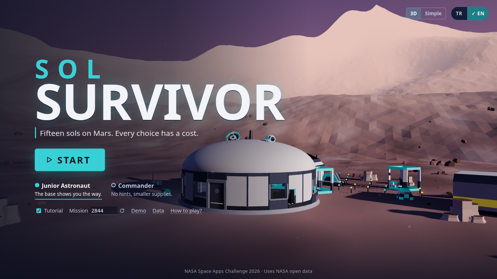
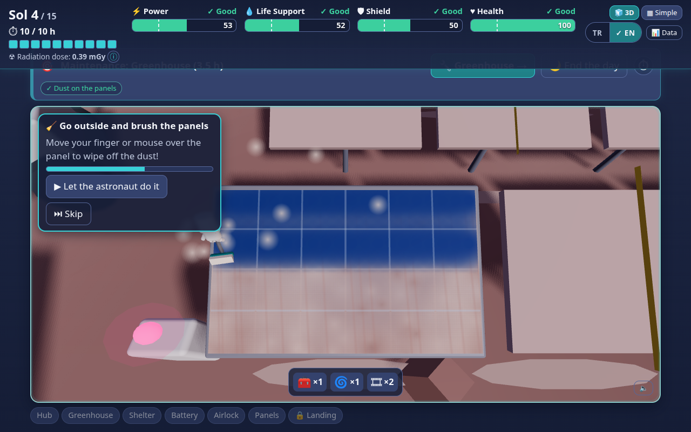

# Sol Survivor

A small browser game for the NASA Space Apps Challenge 2026 task *"Build a Junior Astronaut Mission Trainer"* (ages 7-12). The game is in **Turkish and English** (TR / EN switch on the title screen and in the top bar while playing).

**Play:** <https://alicagriyildiz.github.io/sol-survivor/>

<p>
  
  
</p>

You are the only astronaut on a Mars base. A resupply lander arrives on sol 15, and until then you must keep **Power**, **Life Support** and **Shield** up. Every fix costs something: work hours, another resource, a spare part, or trouble later. After the mission, the **Black Box** lets you change one decision, predict what would happen, and then see both missions side by side, with a plain-language explanation of why they differ.

## How to play

1. Pick a level: **Junior Astronaut** (hints on: the task line shows where the problems are and which gauge is weakest) or **Commander** (no hints, and the base starts with less Power and Life Support). The mission number sets the dice, so the same number always gives the same mission.
2. Each sol starts with a briefing: the day's problems and where they are, weather, space weather and a message from Earth.
3. You see the base in **first person**. Drag to look around; click a station (or its button) and the astronaut walks there. You see the problem in the world, read the options (cost in hours, what goes up or down) and choose one.
4. The chosen job is then done in front of you, or **by hand with a simple gesture**: wipe the dust off a solar panel, hold to patch a leak or swap a filter, and so on. You can also let the astronaut do it or skip. The outcome depends on the option you chose, not on how well you wipe.
5. Results stay in the world (a cleaned panel stays clean, sandbags stay stacked), and a problem you put off visibly gets worse (faster alarm lights, thicker dust, more steam).
6. End the sol. The report shows the sol number, the biggest changes (for example `54 → 45`), a "what really happened" note from a real mission, and sometimes a NASA study. Details are one click away.
7. If a gauge falls into the red, Health drops every hour. Each gauge has a one-time emergency reserve that kicks in at the same red line, but it is not free: that system then wears out a little faster every night.
8. The mission ends with a short, skippable scene: the resupply lander lands and lifts off with you, or, if the mission ends early, an emergency capsule picks the astronaut up (no one dies). Then the Black Box invites you to change one decision.

If 3D cannot start (no WebGL, an error, or you choose it), the game falls back to the **simple card view**, which has the same rules and content.

The title screen has a **Demo** button: four stops (sol 4, sol 6, sol 12, mission end → Black Box) on a fixed mission (seed 148, where sol 12 is the real X8.2 flare of 10 Sep 2017). The rehearsed 3-minute path is in [`docs/DEMO.md`](docs/DEMO.md).

## Real NASA data

The severity of the sol 12 solar event comes from **real solar flares in NASA's DONKI database**. They range from a C7.6 flare (Jan 2025) to the X8.2 flare of 10 Sep 2017, whose particles reached Mars. The briefings forecast the event, and the sol 12 panel and helmet display show its date, class and source.

The dose meter is anchored to **Curiosity RAD's** measured Mars surface dose. The end screen compares your dose with **ISS measurements from NASA OSDR RadLab**. Storm sols use values NASA published for **Opportunity in the 2018 global dust storm**. Sol reports link four **NASA OSDR** space-biology studies.

The data was downloaded once (`npm run fetch-data`) and is bundled with the game, which makes no network calls. Event strength comes from data; the effect on the base is computed with a simplified game scale, and the in-game **Data** screen says so. Details, sources, scale functions and limits are in [`docs/DATA.md`](docs/DATA.md). 14 of the 15 "what really happened" notes were checked against official NASA/JPL pages ([`docs/SOURCES.md`](docs/SOURCES.md)).

## Balance (measured with bots, 200 seeds each)

Numbers from `npm run balance` and `tests/commander.test.ts`, on the current code:

| Bot | Junior Astronaut | Commander |
|---|---|---|
| Careful player | 83.5% wins | 44% |
| Follows the on-screen hints literally | 77.5% | 0% |
| Random choices | 19.5% | 2.5% |
| Always the most robust option | 30% | 0% |
| Always the cheapest option | 3% | 0% |
| Does nothing | 0% | 0% |

On Junior, 45.3% of the random bot's lost missions are saved by changing a single decision (36.6% if the astronaut does nothing after the original log ends). No bot loses on sol 1. All **104 tests** pass (`npm test`).

## Run

```bash
npm install
npm run dev          # play at http://localhost:5173
npm test             # core, determinism, replay, counterfactual, content, data, language, world and balance tests
npm run balance      # balance bots only
npm run build        # type-check + production build (served under /sol-survivor/)
npm run fetch-data   # re-download the NASA data snapshots into src/data/
```

Every push to `main` deploys to GitHub Pages (`.github/workflows/deploy.yml`).

## Structure

- `src/sim/` – pure, deterministic simulation core (seeded RNG, immutable state)
- `src/content/` – the 15-sol scenario as data, balance knobs, mission configs (Junior / Commander), data-to-game scale functions (`data.ts`), presentation-only action kinds for the 3D jobs (`actions.ts`)
- `src/content/lang/` – all player-facing text, Turkish (`tr.ts`) and English (`en.ts`); a test checks that both have the same keys
- `src/data/` – NASA data snapshots (DONKI, RadLab, OSDR) and hand-entered published values
- `src/blackbox/` – replay, counterfactual, explanation, rescue search
- `src/bots/` – balance bots
- `src/ui/` – screens, simple card view, Black Box
- `src/scene/` – first-person 3D view (lazy chunk): world, hab, hand and tools, one file per station, end-of-mission scenes, title backdrop
- `public/models/kenney/` – CC0 low-poly models (Kenney Space Kit), see `CREDITS.md`
- `scripts/fetch-data.mjs` – one-time data download
- `docs/` – design, data, sources, demo path, progress, screenshots

No accounts and no network calls at runtime. No external images, fonts or sounds; the only third-party art is CC0 3D models (Kenney Space Kit, see `CREDITS.md`). This is not an official NASA product.

## Team

- Team: [TEAM NAME]
- Members: [MEMBERS]
- Local event: Sivas, Türkiye
- Challenge: Build a Junior Astronaut Mission Trainer

## AI use disclosure

- The code was written with the help of **Claude Code (Anthropic)**, an AI coding assistant. Commits made with it list it as a co-author.
- The game idea, rules, scenarios, balance targets, playtesting and direction are the team's.
- No AI-generated images or art: the 3D models are the Kenney Space Kit (CC0); everything else is built from simple shapes in code.
- Sounds are generated in code in the browser (Web Audio); there are no sound files.
- No NASA logo or mission insignia is used anywhere in the game.
- This is not an official NASA product.

## License

MIT (code). 3D models: Kenney Space Kit, CC0 1.0 (`CREDITS.md`). NASA data is used under NASA's media and data guidelines; see `docs/DATA.md` for attribution.
